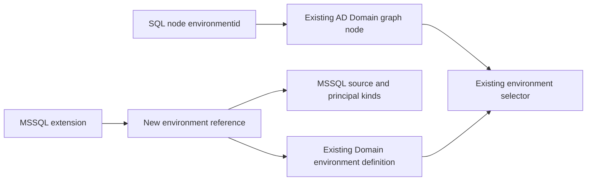

# Implementation plan for native BloodHound environment references

Date: October 23, 2026. Status: proposed implementation, awaiting review.

Enable an OpenGraph extension to use existing Active Directory `Domain` and Azure
`AZTenant` nodes as its environments. Keep the extension's source and principal
registrations separate from the built-in AD/Azure registrations. For MSSQL, the
result is domain-wide findings scope using the same Domain node already collected
by SharpHound.

This plan proposes changes to BloodHound's OpenGraph implementation. It does not
change code, schemas, data, or deployed services. Implementation requires a
separate authorization. It requires no OpenHound or collector-common changes.

## Intended behavior

An MSSQL extension may submit this environment entry without declaring `Domain`
in its own `node_kinds`:

```json
{
  "environment_kind": "Domain",
  "source_kind": "MSSQL",
  "principal_kinds": [
    "MSSQL_ApplicationRole",
    "MSSQL_Database",
    "MSSQL_DatabaseRole",
    "MSSQL_DatabaseUser",
    "MSSQL_Login",
    "MSSQL_Server",
    "MSSQL_ServerRole"
  ]
}
```

Each listed kind must still be declared by the MSSQL extension. This preserves
the existing meaning of `principal_kinds`; it does not redesign which SQL objects
should count as principals. Any change to that list is a separate decision.

A SQL node's `environmentid` is the object ID of its host's existing AD Domain
node. Its primary kind and stable object ID remain unchanged. Its `MSSQL`
secondary kind continues to identify its source. A remote linked-server node uses
its own host's domain. A server whose domain cannot be established does not get a
guessed environment or a fabricated Domain node.

The equivalent Azure entry uses `environment_kind: "AZTenant"`, its own extension
source, and its own declared principal kinds. Its node environment IDs refer to
existing Azure tenant object IDs.

SCCM continues to use the hierarchy-root `SCCM_Site` environment. Its environment
definition and payloads do not change for this proposal.

The environment selector continues to show the existing domain or tenant once.
A Domain stays an Active Directory environment. This proposal does not introduce
a second MSSQL platform entry for the same Domain. Source filtering and finding
types distinguish MSSQL content within that existing environment.

## Current restrictions and existing support

The public source reviewed is BloodHound commit
`4cc701822fa7f6837c9bba0861550f089dd3bc53`, from October 23, 2026. Before
implementation, record the actual BHE revision and its BHCE submodule revision,
and check these locations against that revision. The private BHE analysis call
sites remain an explicit implementation prerequisite.

| Current restriction | Effect on a Domain reference | Source |
| --- | --- | --- |
| Environment names require the extension prefix | `Domain` fails validation | [GraphExtensionInput.Validate](https://github.com/SpecterOps/BloodHound/blob/4cc701822fa7f6837c9bba0861550f089dd3bc53/cmd/api/src/model/graphschema.go#L593) |
| Environment names must appear in the submitting extension's node kinds | A prefix exception alone still fails | Same validation function |
| Environment kind IDs are globally unique in the environment table | A second Domain registration conflicts with AD | [Database uniqueness constraint](https://github.com/SpecterOps/BloodHound/blob/4cc701822fa7f6837c9bba0861550f089dd3bc53/cmd/api/src/database/migration/migrations/00000000000001_init.sql#L2355) |
| Environment lookup keeps one definition per kind | Returning competing definitions could overwrite one entry | [Legacy service](https://github.com/SpecterOps/BloodHound/blob/4cc701822fa7f6837c9bba0861550f089dd3bc53/cmd/api/src/services/opengraphschema/extension.go#L203) and [new service](https://github.com/SpecterOps/BloodHound/blob/4cc701822fa7f6837c9bba0861550f089dd3bc53/server/opengraphschema/internal/services/services.go#L49) |

There is already a separate capability for findings to refer to environments
declared by another extension. [PR 2574](https://github.com/SpecterOps/BloodHound/pull/2574)
includes a Domain example; [PR 3282](https://github.com/SpecterOps/BloodHound/pull/3282)
decouples finding references from environment-definition ownership. Preserve that
capability. The new work concerns registering a source and its principal kinds
against a built-in environment, including their update and removal behavior.

The MSSQL schema copies currently contain `relationship_findings: []`. This
proposal does not invent production MSSQL findings. Use an explicitly labelled
test finding for BHE verification; selecting production finding types is separate
work. Findings and metrics need independent checks.

## Selected design

Keep one canonical environment definition for each kind. Here, canonical means
the existing database registration owned by AD or Azure. It is metadata about a
kind; it is different from the Domain or AZTenant graph nodes representing actual
domains and tenants.

Add separate extension-owned reference records. A reference says, for example,
“MSSQL contributes these principal kinds to the existing Domain environment.” It
does not give MSSQL ownership of that environment or its graph nodes.



Keep the schema JSON shape unchanged. Entries in `environments` are classified
as built-in references only when their kind is exactly `Domain` or `AZTenant`.
All other entries retain the current rules for an environment owned by the
submitting extension. Referencing arbitrary third-party environments is outside
this change.

Two new tables keep ownership clear without changing the existing principal
membership table. Existing owned-environment queries keep their meaning. New
analysis queries combine native registrations and extension references when they
need the effective source/principal membership.

## Proposed schema validation changes

Modify `cmd/api/src/model/graphschema.go` and its validation tests.

Add a small shared predicate using BloodHound's existing graph-kind constants.
The following is proposed Go code, not a patch that has been applied:

```go
// IsBuiltinEnvironmentReference reports whether a schema entry may refer to
// an environment supplied by BloodHound's AD or Azure extension.
func IsBuiltinEnvironmentReference(kindName string) bool {
    return kindName == ad.Domain.String() || kindName == azure.Tenant.String()
}
```

Import the AD/Azure graph-schema packages if they are not already imported. Check
the build dependency direction before using this placement; move the predicate
to an existing shared graph-schema package only if the imports would create a
cycle. Do not duplicate literal names across validation and persistence.

Change the environment-validation loop as follows:

1. Determine whether the entry is a built-in reference.
2. For an owned environment, retain both the prefix check and the requirement
   that it be declared in this extension's node kinds.
3. For a built-in reference, skip those two checks only for the environment kind.
4. Retain the remaining checks: one entry per environment kind, a nonempty source,
   source/node/edge naming conflicts, and this extension's declared principal kinds.
5. Retain all current namespace checks on node and relationship definitions. An
   extension still cannot submit a `Domain` node definition or replace its display
   information. `domain`, `AZTENANT`, `Tenant`, `Domain_Anything`, `User`, and
   third-party environment names receive no special treatment.

The core change should read approximately as follows; existing validation and
error messages surrounding it must be retained:

```go
isBuiltinReference := IsBuiltinEnvironmentReference(environment.EnvironmentKindName)
if !isBuiltinReference {
    // Run the existing namespace and local-node-declaration checks here.
}
// Run the existing source, duplicate-entry and principal-kind checks here.
```

Validation based on database contents belongs in the save operation. Check that
the target environment is installed, owned by a built-in extension, and of the
allowed kind. A plain row in the global kind table is insufficient. Reject a
reference source that would take over a built-in source such as `Base` or
`AZBase`. Return a clear validation error if the target registration is missing;
do not create a placeholder environment definition.

Schema installation may precede AD/Azure data collection. The target metadata
must exist, but individual Domain/AZTenant graph nodes need not exist yet.

## Proposed database migration

Add a new Goose migration under
`cmd/api/src/database/migration/migrations/`, named with the actual implementation
timestamp, current major version, and `add_builtin_environment_references`.
Do not edit the initial schema or an already merged migration. The SQL below
shows the proposed new records and constraints; adapt naming to upstream review.

```sql
-- +goose Up
CREATE TABLE schema_environment_references (
    id SERIAL PRIMARY KEY,
    schema_extension_id INTEGER NOT NULL
        REFERENCES schema_extensions(id) ON DELETE CASCADE,
    environment_id INTEGER NOT NULL
        REFERENCES schema_environments(id) ON DELETE RESTRICT,
    source_kind_id INTEGER NOT NULL REFERENCES kind(id),
    created_at TIMESTAMP WITH TIME ZONE NOT NULL DEFAULT current_timestamp,
    updated_at TIMESTAMP WITH TIME ZONE NOT NULL DEFAULT current_timestamp,
    UNIQUE (schema_extension_id, environment_id),
    UNIQUE (environment_id, source_kind_id)
);

CREATE INDEX idx_schema_environment_references_environment_id
    ON schema_environment_references(environment_id);

CREATE TABLE schema_environment_reference_principal_kinds (
    reference_id INTEGER NOT NULL
        REFERENCES schema_environment_references(id) ON DELETE CASCADE,
    principal_kind INTEGER NOT NULL REFERENCES kind(id),
    created_at TIMESTAMP WITH TIME ZONE NOT NULL DEFAULT current_timestamp,
    PRIMARY KEY (reference_id, principal_kind)
);

CREATE INDEX idx_schema_environment_reference_principals_kind
    ON schema_environment_reference_principal_kinds(principal_kind);
```

`schema_extension_id` identifies the extension that may change or remove the
reference. `environment_id` points to the built-in metadata row, not a particular
domain SID or tenant object ID. Object IDs continue to travel in graph payloads.

The first unique constraint makes repeated uploads update one reference. The
second prevents two referencing extensions from claiming the same source under
one built-in environment. Also check the canonical environment's own source in
the save operation, since it lives in another table. Do not broaden this proposal
into a new global source-naming policy for existing owned environments.

The principal membership rows belong to a reference. Removing that reference
therefore removes only its contributions. References to the same Domain kind by
two different sources remain independent.

The down migration must refuse rollback while reference records exist. Use the
repository's Goose statement block style and raise an actionable error telling
the operator to remove the references using a server that understands them.
Once the tables are empty, drop the membership table and then the reference
table. Do not silently erase active registrations on downgrade. No data backfill
is needed because the current server cannot save these references.

Proposed downgrade SQL:

```sql
-- +goose Down
-- +goose StatementBegin
DO $$
BEGIN
    IF EXISTS (SELECT 1 FROM schema_environment_references) THEN
        RAISE EXCEPTION
            'Remove native environment references with a supporting server before downgrading';
    END IF;
END;
$$;
-- +goose StatementEnd

DROP TABLE schema_environment_reference_principal_kinds;
DROP TABLE schema_environment_references;
```

The downgrade must run while schema writes are stopped, using the normal
deployment migration procedure. The reference foreign key prevents orphaned
membership rows; refusing when references exist preserves active registrations.

## Proposed models and persistence methods

Add models in `cmd/api/src/model/graphschema.go` or a focused companion file:

- `SchemaEnvironmentReference`, carrying its ID, owning extension ID, target
  environment ID, source kind ID, and timestamps. Use the repository's existing
  serial/timestamp conventions.
- `SchemaEnvironmentReferencePrincipalKind`, carrying reference ID and principal
  kind ID.
- An internal projection for effective analysis registrations, described below.

Keep `SchemaEnvironment`, its one-kind lookup, and its existing query meanings
unchanged. This prevents existing UI callers from accidentally treating each
reference as another environment.

Add a focused persistence file, proposed as
`cmd/api/src/database/upsert_schema_environment_reference.go`, with these responsibilities:

| Proposed method | Responsibility |
| --- | --- |
| `GetEnvironmentReferencesByExtensionId` | Read only the submitting extension's references, including target kind names needed to compare repeated uploads. |
| `CreateEnvironmentReferenceWithPrincipalKinds` | Resolve and verify the built-in target, register the extension source, create the reference, and add its principal kinds. |
| `UpdateEnvironmentReferenceWithPrincipalKinds` | Update only this reference's source and reconcile only its principal kinds. |
| `DeleteEnvironmentReference` | Delete this reference; its membership rows are removed by the database. |

Use the existing database instance and upload transaction. Do not open an
independent transaction inside these helpers. Before inserting a principal, verify
that its declared node kind belongs to the submitting extension. An external kind
name must not acquire membership through a direct database call that bypasses the
JSON validator.

Use the existing reconciliation helper to compare desired and saved principal
kinds: add new entries, leave matching entries, and remove missing entries.
Preserve the reference ID on an unchanged repeated upload. Database uniqueness
constraints must handle competing uploads deterministically. Verify concurrent
uploads for the same extension; if existing transaction locking does not serialize
that case, lock the submitting extension row within the upload transaction before
reconciling its references. Keep lock order consistent.

Define specific errors for a missing built-in environment, an attempt to use a
built-in source, and a conflicting reference source. Extend the existing
database-error-to-validation-error translation so these become useful HTTP 400
responses. Unexpected database failures remain server errors. Do not expose raw
SQL errors to the user.

## Proposed upload update and removal flow

Modify `cmd/api/src/database/upsert_schema_extension.go`.

Split `EnvironmentsInput` into owned entries and built-in-reference entries using
the shared predicate. Pass owned entries to the existing
`environmentReconcileConfig`. Add a parallel reference reconciliation keyed by
target environment kind. It operates only on references owned by this extension.

The upload transaction should perform these actions:

1. Find or create the submitting extension using existing rules.
2. Save its node and relationship definitions through the existing flow.
3. Reconcile its owned environments from the owned input list.
4. Reconcile its built-in references from the reference input list.
5. Save findings, saved queries, and privilege-zone rules as before.
6. Commit only after every operation succeeds.

A failed reference must roll back the entire upload, including earlier kind
changes. An entry removed from a subsequent schema upload removes that extension's
reference. Removing its last principal kind leaves a valid empty contribution
if the schema explicitly retains the reference; omitting the reference removes it.
Preserve the existing validator's policy for empty principal lists unless upstream
review elects to change that policy separately.

Add `EnvironmentReferencesResult` to `GraphExtensionUpsertResult`, following its
existing typed reconciliation results. Update upload logging in
`cmd/api/src/services/opengraphschema/extension.go` to report reference creation,
update, and removal separately from canonical environment changes. An audit
record should identify the extension, target kind, source, and membership counts.
Do not log collection credentials.

Deleting an extension through `DeleteGraphSchemaExtension` should let the new
extension foreign key remove its reference rows and their membership rows. Keep
the existing built-in deletion protection. Do not call `DeleteEnvironment` for
a built-in reference. Schema deletion and deletion of ingested graph data are
different operations; test them separately.

Review node-kind reconciliation when a referenced principal kind is removed from
the same upload. The final transaction must contain neither stale memberships nor
partially saved definitions. Do not rely on global kind IDs disappearing: the
global kind registry can outlive an extension's node definitions.

If the product exposes schema export or schema-detail reconstruction, combine
owned entries and reference entries back into its `environments` output. An
export/import round trip must retain the reference. Confirm the relevant BHE
endpoint rather than assuming the public extension-list endpoint is an exporter.

## Proposed analysis and selector changes

### Keep the environment selector canonical

Keep `GetEnvironmentsFiltered`, `GetEnvironmentByEnvironmentKindId`, and
`GetEnvironmentKindName` returning canonical environment definitions. Keep
`EnvironmentKindsToEnvironment` as one entry per kind. Keep both the legacy
OpenGraph schema service and the newer `server/opengraphschema` service on those
canonical reads.

`BuildEnvironmentSelectors` and `resolveEnvProperties` in
`cmd/api/src/api/v2/search.go` should therefore continue to return one existing
Domain or AZTenant selector, with unchanged built-in type, name, object ID, and
collected status. Add regression tests for references being installed, updated,
and removed; do not change UI behavior unless those tests expose a real gap.

### Make principal and source registrations explicit

The analysis layer must be able to read all contributions without overwriting
the canonical environment's source. Add a focused reader, proposed as
`GetEnvironmentSourceRegistrations`, and an internal model with:

```go
type EnvironmentSourceRegistration struct {
    SchemaExtensionId int32 // Extension responsible for this contribution.
    EnvironmentId     int32 // Canonical schema environment row ID.
    EnvironmentKindId int32 // Domain, AZTenant, or an owned environment kind.
    SourceKindId      int32 // Base, AZBase, MSSQL, or another declared source.
    PrincipalKindIds  []int32
}
```

Return one registration per owning extension, canonical environment, and source.
Combine existing owned registrations with the new reference rows. Keep the
different source/principal lists available to callers; do not select the first
source for a Domain, and do not replace `Base` with `MSSQL`.

For `GetPrincipalKindsGraphKinds`, combine the old membership table with the new
reference membership table and return distinct kind IDs. A query fragment for
the combined membership is:

```sql
SELECT principal_kind
FROM schema_environments_principal_kinds
UNION
SELECT principal_kind
FROM schema_environment_reference_principal_kinds;
```

The real query must retain the existing feature-flag filtering and use the
extension that owns the contribution to decide whether it is built-in. A
reference to Domain does not turn a custom extension's principal kinds into
built-in kinds. When OpenGraph findings are disabled, omit custom references
even though their target is built-in.

If a caller requests effective membership for one canonical environment, union
only references to that environment. Keep extension-upsert readers restricted
to owned rows so an upload cannot remove another extension's contributions.
Use distinct principal IDs for aggregate membership, while preserving separate
source registrations where analysis depends on source context.

### Audit BHE consumers before coding is considered complete

Search the exact BHE checkout and shared BHCE submodule for:

```text
GetPrincipalKindsByEnvironmentId
GetPrincipalKindsGraphKinds
GetEnvironmentKindName
GetEnvironmentByEnvironmentKindId
SchemaEnvironment.SourceKindId
EnvironmentKindsToEnvironment
schema_environments_principal_kinds
schema_environments
```

Classify each call as a display/ownership read or an analysis membership/source
read. Retain canonical reads for the former. Switch the latter to the effective
registration reader when they need custom contributions. Record concrete BHE
files, function names, and tests in this plan before implementing that part.
No private filenames are assumed here.

Verify that a SQL origin can contribute a finding to its existing AD Domain,
with the MSSQL source retained for traversal and metric rules. Verify the Azure
equivalent. Check whether native scoping paths use `domainsid` or `tenantid`
instead of, or alongside, generic `environmentid`. Do not add those properties
to every collector node without a failing test and a documented contract.

For cross-domain paths, apply the finding engine's established scoping rule to
the source/target roles; do not invent a new rule based on whichever endpoint
appears first. Use two domains and a remote SQL stub to make this visible.

BHE permission checks must continue to use the existing environment object IDs.
Installing a reference must not let a user view a Domain/AZTenant they were not
already permitted to view. Metrics must avoid counting the same graph node twice
when it qualifies through multiple registrations.

Current finding persistence already permits foreign environment kinds. Preserve
its global kind references and existing migration. Do not revert to making a
finding belong to the new reference row. Removing a reference's principal
contribution and deleting an extension's finding definitions must follow their
respective existing ownership rules.

## File by file work list

Paths in this table are relative to the BloodHound repository. New filenames are
proposed names, not existing files.

| Area | Proposed changes |
| --- | --- |
| `cmd/api/src/model/graphschema.go` | Built-in-reference predicate, validation branches, reference models, analysis projection, reconciliation result. |
| `cmd/api/src/database/migration/migrations/<timestamp>_v9_add_builtin_environment_references.sql` | New reference and membership tables, constraints, guarded downgrade. Confirm the major version at implementation. |
| `cmd/api/src/database/upsert_schema_environment_reference.go` | New reference and membership save/read/delete helpers. |
| `cmd/api/src/database/upsert_schema_extension.go` | Split owned versus referenced environment inputs and reconcile each within one transaction. |
| `cmd/api/src/database/graphschema.go` and its database interface declarations | Add reference/analysis-reader methods; include referenced principal kinds in effective reads. Preserve canonical-reader behavior. |
| `cmd/api/src/services/opengraphschema/extension.go` | Reference error translation and reconciliation logging; preserve canonical selector lookup. |
| `server/opengraphschema/internal/appdb/store.go` and `internal/services/services.go` | Inspect active routes; keep selector reads canonical and add analysis readers only if the routed code needs them. |
| Generated database/service mocks | Regenerate with upstream tools after interface changes. Do not hand-edit generated output. |
| `cmd/api/src/api/v2/opengraphschema.go` | Verify HTTP error handling and JSON/ZIP parity; retain existing API shape. |
| `cmd/api/src/api/v2/search.go` | Expected behavior unchanged; test selector uniqueness and native classification. |
| BHE findings, metrics, and access-filter callers | Concrete paths must be identified from the BHE checkout before implementation. Adopt the effective registration reader where necessary. |
| Official schema documentation and examples | Explain native references, ownership, namespace exceptions, required graph IDs, and removal behavior. |

No new runtime dependency is proposed. Keep the existing Go toolchain, database
libraries, migration tools, and generated API tooling. The inspected `go.mod`
declares Go 1.27.3; use the actual target revision's declared version.

## Test plan

For upstream Go tests, propose extending the repository's existing sibling
`*_test.go` and `*_integration_test.go` files, as its AGENTS.md requires. This
differs from the local collector convention of a separate `tests/` directory;
confirm that upstream-specific layout before implementation. Collector tests
remain under each collector's `tests/` directory. Use the established integration
build tags and test-database setup.

### Validation tests

- Accept a Domain reference without a local Domain node definition.
- Accept an AZTenant reference without a local tenant definition.
- Continue accepting ordinary prefixed environments.
- Reject an unprefixed custom environment, alternate casing, empty names, and a
  namespaced name that consists only of its prefix.
- Reject attempts to define native node kinds, reference another extension's
  principal kinds, or use a source that conflicts with local node/edge kinds.
- Reject duplicate references and distinguish a missing built-in registration
  from a missing graph-data instance.
- Retain foreign `relationship_findings[].environment_kind` behavior.

### Database and lifecycle tests

Seed the normal AD and Azure metadata, then verify:

| Scenario | Required result |
| --- | --- |
| First MSSQL Domain-reference upload | One new MSSQL reference; existing Domain registration, source, display data, and principal membership unchanged. |
| Identical second upload | Same reference ID and memberships; no duplicates. |
| Add/remove a SQL principal kind | Only that reference's membership changes. |
| Two sources reference Domain | Each contribution remains independently owned. |
| Duplicate source under Domain | Useful validation error; no partial data. |
| Reserved native source | Rejected without changing Base/AZBase. |
| A later upload fails | All mutations roll back. |
| Reference omitted from new schema | Its memberships disappear; AD/Azure and other references remain. |
| Extension removed | Its references disappear; built-in metadata remains. |
| Principal node definition removed | No stale principal membership survives. |
| Concurrent same-extension uploads | One consistent registration; no duplicate or mixed memberships. |
| No Domain graph data yet | Schema reference installs; no dummy graph node appears. |
| OpenGraph findings disabled | Custom contributions are excluded from effective principal/source reads. |
| Migration on populated database | Native IDs, sources, kinds, and memberships remain byte-for-byte equivalent in the relevant fields. |
| Down migration with references | Actionable refusal; no data loss. |
| Down migration after references removed | Successful table removal. |

Run integration tests for canonical environment lookup and the new reference
reader. Check both legacy and actively routed newer services. Use endpoint tests
for HTTP status codes, error text, repeated uploads, and JSON versus ZIP input.
For ZIP tests with findings, satisfy the current bundle requirements for a
privilege-zone-rules component rather than treating a bundle-validation error as
an environment failure.

### Graph and BHE verification

Use a disposable BHE test database. Keep active collection inside the authorized
mayyhem.com lab; synthetic Azure fixture data needs no collection against a live
tenant. Obtain the real lab Domain SID from existing AD data instead of using
an invented SID in a claimed live test.

1. Record the IDs, kinds, properties, selector entries, and native baseline
   findings/metrics for an existing AD Domain and a synthetic Azure tenant.
2. Install the reference schema and a clearly labelled test finding. Confirm
   successful schema upload before ingesting graph files.
3. Ingest two SQL instances in the same domain with several SQL principal kinds,
   plus a remote SQL stub in another domain. Reuse existing IDs.
4. Run BHE analysis. Verify the test finding appears under the existing domain,
   and verify applicable exposure/impact counts and principal membership.
5. Repeat equivalent checks with AZTenant, and with restricted environment access.
6. Re-ingest and re-upload the same inputs. Verify stable counts and no duplicate
   environment selector entries or findings.
7. Remove one reference and rerun analysis. Verify another referencing extension
   and native AD/Azure registrations remain usable.
8. Delete the test extension definition; verify native metadata and graph nodes
   remain. Separately test removal of its ingested source data and prove it does
   not delete the existing Domain/AZTenant nodes.

Record actual-versus-expected outputs. A successful schema upload proves only
schema acceptance. It does not prove analysis, permissions, removal, or metrics.
Any BHE behavior that fails remains a completion blocker, not an undocumented
limitation in a supposedly finished PR.

### Proposed commands

Run these later from a full BloodHound checkout on its supported development
host. The downloaded review snapshot is not a runnable checkout. Use the target
revision's Go version and test databases; no environment is provisioned by this
planning task.

```bash
go test ./cmd/api/src/model ./cmd/api/src/services/opengraphschema ./cmd/api/src/api/v2
go test ./server/opengraphschema/...

# Requires configured disposable integration databases.
go test -tags=integration ./cmd/api/src/database/... ./server/opengraphschema/...

# The CI test commands checked at the reviewed revision.
go tool stbernard test -g -r
go tool stbernard test -g -i -r

# Required upstream generation, analysis, and review preparation.
just prepare-for-codereview
```

Start with the relevant test functions while developing, then run the required
broader checks before review. `just prepare-for-codereview` is not a substitute
for the explicit test runs: the inspected recipe performs generation and
analysis tasks. Add the actual BHE analysis test commands after identifying the
private call sites. Do not invent an Enterprise test command in this plan.

## Alternatives considered

| Alternative | Reason for not selecting it for this plan |
| --- | --- |
| Prefix exception only | Still fails local-node declaration and database uniqueness checks. |
| Allow the extension to define Domain/AZTenant | Lets the extension claim native definition/display ownership and does not solve lifecycle separation. |
| Remove the environment-kind uniqueness constraint | Creates competing registrations and requires changing consumers that assume one definition per kind. |
| Add SQL principals directly to AD's existing membership rows | The current rows do not record the contributing extension, making update/removal ownership unclear. It also leaves the MSSQL source association unresolved. |
| Create MSSQL_Domain proxy nodes | Does not meet the requirement to use existing native Domain nodes. |
| Add an explicit new JSON environment-reference field | Makes the distinction visible, but requires a wider schema/API change. Reconsider only if maintainers reject the meaning assigned to the two allowed names. |
| Define only Domain-scoped relationship findings using current support | Useful for a small proof of existing functionality, but does not establish source/principal registration and metrics behavior required here. |

## Delivery order and review decisions

Before implementing, present this proposal to the owner and the BloodHound
maintainers. [The contribution guide](https://github.com/SpecterOps/BloodHound/wiki/Contributing#before-opening-an-issue-or-pull-request)
requires an associated GitHub issue or internal Jira ticket. Do not open an issue,
publish a PR, or contact others without the owner's instruction. Proposed issue
title: **Allow OpenGraph sources to reference built-in Domain and AZTenant environments**.

Use this implementation order:

| Work item | Deliverable and completion evidence | Planning estimate |
| --- | --- | --- |
| Confirm BHE readers and accepted scope | Exact revision, concrete BHE call-site list, agreement on the two-table design and JSON behavior. | 0.5–1 day |
| Validation and storage | Validation tests, migration up/down tests, and reference lifecycle tests. | 1.5–2.5 days |
| Upload and effective registrations | Transactional updates, useful errors/logs, reader tests, unchanged selector results. | 1–2 days |
| BHE analysis and access checks | Verified Domain/AZTenant findings, metric counts, cross-domain scope, and permission tests. | 1–3 days |
| Documentation and complete review checks | Examples, release notes, migration notes, signed commit proposal, and passing required checks. | 0.5–1 day |

These are preliminary engineering estimates of approximately 5–10 working days,
excluding maintainer review. Existing private BHE assumptions may increase the
analysis portion. Do not claim the shorter validation work is the whole feature.

Before coding, confirm these design decisions with reviewers:

- Only Domain and AZTenant may be referenced through this exception.
- Existing `environments` JSON entries distinguish references by those exact names.
- The canonical built-in sources and selector identities stay unchanged.
- Reference sources cannot impersonate native sources or another reference to the
  same target. Principal kinds remain owned by the referencing extension.
- The two additive tables and guarded downgrade are acceptable upstream.
- BHE analysis consumers and upstream test-file layout have been identified.

## Collector documentation and release follow-up

The currently saved MSSQL schemas using `Domain` are still rejected by an
unmodified server. Successful packaging tests were not evidence of server
acceptance. Keep that distinction explicit in any change record.

Once a supporting server build is verified, update ConfigManBearPig and
openhound-mssql documentation and their environment-scope change records to name
the first supported server version. Keep the two MSSQL schema copies synchronized.
Add a schema-acceptance regression fixture tied to the real server validation
path, rather than testing only that the JSON contains the intended string.

If BHE proves additional graph properties are required, propose and test that
collector change separately, update the README and relevant ARCHITECTURE sections,
and compare conversion output against fixed saved collection data. Do not edit
OpenHound or collector-common to deliver this feature without their separate
owner-approved proposals.

Existing SQL node IDs, the native Domain/AZTenant IDs, and SCCM hierarchy-root
scope should need no rewrite. If findings or historical metrics require
recalculation, document the supported analysis rerun procedure and its expected
effects rather than deleting graph data as a workaround.

## Completion criteria and proposed commits

The feature is complete when both built-in references install through the real
API, custom registrations contribute correctly to BHE analysis and metrics, native
selector/access behavior is preserved, updates and removal affect only the
referencing extension, and migration/rollback tests pass. JSON inspection alone
cannot satisfy these criteria.

Suggested upstream commit title:

```text
feat(opengraph): support built-in environment references <approved issue or Jira ID>
```

Its body should explain native-reference validation, separate source/principal
ownership, additive tables and downgrade guard, preserved AD/Azure definitions,
effective analysis readers, actual passing tests, BHE evidence, and no new runtime
dependencies. Split implementation into reviewable commits if maintainers prefer,
but keep the feature deployable only when its full read/write path is ready.

The owner performs Git actions after reviewing the finished implementation.
Example commands below are for that later implementation, not for staging this
proposal or today's unrelated collector edits:

```bash
git status --short
git add -p -- cmd/api/src/model cmd/api/src/database cmd/api/src/services/opengraphschema cmd/api/src/api/v2 server/opengraphschema
git add -- cmd/api/src/database/upsert_schema_environment_reference.go
git add -- 'cmd/api/src/database/migration/migrations/<actual-migration-filename>.sql'
# Explicitly add reviewed new test files and generated mocks after checking their paths.
git diff --cached --stat
git diff --cached
git commit -S -m "feat(opengraph): support built-in environment references <approved issue or Jira ID>"
```

Use actual paths and an assigned issue identifier. Any BHE changes require a
coordinated separate commit in its repository. Do not stage the complete worktree
by default. No commit or push is part of this planning task, and no push command
is proposed.
