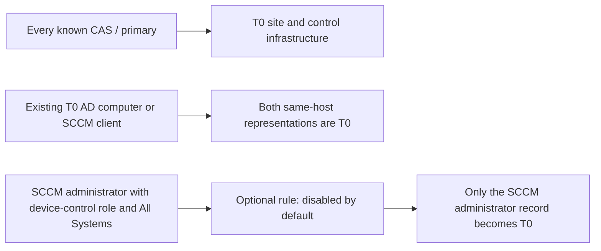

# SCCM extension files

## Saved searches

[`saved_searches/`](saved_searches/) contains the 24 saved BloodHound searches,
previously stored in `cypher_queries/`. From the repository root, upload them with:

```powershell
uv run openhound searches upload .\extension\saved_searches
```

The **SCCM Site Database Service Account to Client Device** search is an example.
Replace `'PS1-DEV'` in the query with the computer name you want to investigate.
It matches names containing the replacement text. Each search keeps its existing
name, so this move does not rename searches already installed in BloodHound.
Use `--strategy overwrite` when you want to update an existing search's description.

## SCCM privilege-zone rules

The current policy protects the SCCM hierarchy without automatically classifying
its administrators as Tier Zero. It has three enabled rules and one optional
administrator rule with `enabled: false`. The earlier seven-rule live tests are
historical evidence; they do not verify the revised defaults. The four current
rules were subsequently installed and checked against the retained privileged
sample: three enabled, the administrator rule disabled, and 32 total T0 objects.
See the
[sample validation report](../docs/privilege-zone-sample-validation.md).

These repository assets use the same JSON format and directory layout as
`openhound-github/extension/privilege_zone_rules`. Each file contains one named,
read-only Cypher selector with `zone: "Tier Zero"` and `allow_disable: true`.
OpenHound's existing `rules upload` command reads them, but currently omits the
`enabled` flag when sending them to BloodHound. Follow the filtered upload
instructions below until the [OpenHound proposal](../docs/openhound-disabled-rules-proposal.md)
has been approved and implemented.

The rules run against the already ingested graph. This change adds no nodes,
relationships, dependencies, collection, preprocessing, or conversion behavior.

## Schema files

[`schema_SCCM.json`](schema_SCCM.json) and
[`schema_MSSQL.json`](schema_MSSQL.json) are ready-to-upload copies of the
collector's schemas. Upload both through **Administration → OpenGraph Management
→ Upload File**. The SCCM copy lists individual administrators and systems using
the Site's existing property arrays. Administrative User panels list individual
role IDs from `memberOf` and collection IDs from `collectionIds`, each linking
to that object. Their control sections contain plain links returning one-hop
paths, including their nodes and relationships. Security Role panels use a
two-column administrator/AD-identity table populated from `members`; their
description stays under Object Information. Collection panels list member
resource keys and provide administrator/AD-identity query links. Client Device
panels list saved collection IDs and provide one-hop control links. No new node
properties or graph ingestion are required. See the
[administrator panel notes](../docs/sccm-admin-user-entity-panel.md),
[role panel notes](../docs/sccm-security-role-entity-panel.md),
[Collection/Client Device notes](../docs/sccm-collection-client-panels.md), and main README's
[registration instructions](../README.md#quick-start)
for graph ingestion and setup.

The originals stay in `src/openhound_sccm/` so installed collectors still include
them. After editing an original, refresh the corresponding copy here. From the
repository root:

```powershell
Copy-Item .\src\openhound_sccm\schema_SCCM.json .\extension\schema_SCCM.json
Copy-Item .\src\openhound_sccm\schema_MSSQL.json .\extension\schema_MSSQL.json
```

Both copies were checked as valid JSON and byte-for-byte matches of the originals.

## Reading the query comments

Short `//` comments explain each query's main checks. The administrator query
names all seven built-in roles and summarizes their potential device-control
paths. In particular, `SMS0001R` is the Full
Administrator **role**, while `SMS00001` is the All Systems **collection**.
Application Author's deployed-application prerequisite and the rules' use of
assumed relationships are explained where those decisions appear.

JSON does not allow comments outside strings, so the comments live inside each
file's `cypher` string. Decode that string to read the query line by line or copy
it into BloodHound:

```powershell
Get-Content .\extension\privilege_zone_rules\t0-hierarchy-administrators.json -Raw |
    ConvertFrom-Json | Select-Object -ExpandProperty cypher
```

The comments travel with the query when the rule is uploaded. They do not change
its executable conditions. No separate query source files need to be kept in sync.

## One policy, with administrator classification optional

| Filename | Default | What the selector returns |
|---|---|---|
| [`t0-hierarchy-sites.json`](privilege_zone_rules/t0-hierarchy-sites.json) | Enabled | Every known CAS and primary site, even without a known Tier Zero client. |
| [`t0-hierarchy-infrastructure.json`](privilege_zone_rules/t0-hierarchy-infrastructure.json) | Enabled | Those sites' active/passive site-server computers, SMS Providers, site databases, SQL instances/hosts, and matching SCCM client representations. |
| [`t0-computers.json`](privilege_zone_rules/t0-computers.json) | Enabled | Both the SCCM client and AD computer when either is already Tier Zero and `SCCM_SameHostAs` connects them. |
| [`t0-hierarchy-administrators.json`](privilege_zone_rules/t0-hierarchy-administrators.json) | **Disabled** | Only SCCM administrator records with a supported built-in device-control role and All Systems in the same hierarchy. |

Role assignments never add administrators or their mapped identities to Tier Zero
under the default policy. This preserves potential findings when those sources
control protected targets. Enabling the optional administrator rule deliberately
moves its qualifying records inside the protected boundary and can suppress
findings for their control of other T0 objects. Other BloodHound rules can still
classify AD users and groups independently.

Each hierarchy selector computes its own site conditions. It does not depend on
another SCCM rule applying a label first. Only the computer-representation rule
needs an existing Tier Zero label.



## How the matches work

**Sites and hierarchy boundaries.** Only `siteType` values
`Central Administration Site` and `Primary Site` qualify as sites. Secondary and
unknown site types are excluded. There is no existing-T0-client requirement;
every collected hierarchy qualifies. The collector's existing bare site-code IDs
still require distinct site codes when combining hierarchies.

**Computer representations.** `SCCM_SameHostAs` connects an SCCM client to its AD
`Computer`. If either already has `Tag_Tier_Zero`, `t0-computers.json` returns both.
An unmapped client cannot establish the required pair. Other clients in the same
hierarchy do not qualify merely because their site is Tier Zero.

**Infrastructure.** The first branch matches computers carrying
`SMS Site Server@<siteCode>` in `SCCMSiteSystemRoles`. The collector gives both
active and passive servers that role. The second branch finds SMS Provider
computers and site databases with `SCCM_AssignAllPermissions` to a qualifying
site. It follows at most three incoming links drawn from `SCCM_SameHostAs`,
`MSSQL_HostFor`, and `MSSQL_Contains` to include the database's SQL instance,
host, and matching SCCM client representation. Output is restricted to those
computer/client/database/server kinds. A co-hosted, unrelated database or SQL
instance does not qualify merely by sharing the host.

MP/DP roles alone and `SCCMInfra: true` are insufficient. An MP/DP host that also
hosts a qualifying control role can still qualify through that role. Stored
credentials alone do not qualify their accounts; other qualifying privileges can.

**Optional administrators.** The supported built-ins are:

| Built-in role | Role ID | Existing control relationship |
|---|---|---|
| Full Administrator | `SMS0001R` | `SCCM_FullAdministrator` |
| Application Author | `SMS0008R` | `SCCM_ApplicationAuthor` |
| Application Administrator | `SMS0009R` | `SCCM_ApplicationAdministrator` |
| Compliance Settings Manager | `SMS0006R` | `SCCM_ComplianceSettingsManager` |
| OS Deployment Manager | `SMS000AR` | `SCCM_OSDManager` |
| Operations Administrator | `SMS000ER` | `SCCM_OperationsAdministrator` |
| Security Administrator | `SMS000FR` | `SCCM_SecurityAdministrator` |

The optional selector requires All Systems (`SMS00001`) in `collectionIds` on
that administrator's exact `SCCM_IsAssigned` edge to a supported role in the same
environment. Separate administrator-to-collection overview edges cannot satisfy
the rule. Older assignments without this evidence do not qualify; recollect and
upload the replacement graph before using the updated selector. It requires neither All
Users and User Groups (`SMS00004`) nor the All security scope. It deliberately
does not depend on `SCCM_AllPermissions`, whose current builder requires both
global collections. Device-wide execution and unrestricted administrative
permission assignment are separate capabilities.

An administrator with only a narrower collection does not qualify, even if that
collection contains a T0 client. A custom role or Read-only Analyst with All
Systems does not qualify either.
Application Author is a potential route: it needs an editable deployed application
that reaches the target. The current collector does not confirm that prerequisite.
Security Administrator's device-control route uses ordinary Full Administrator
delegation within its allowed collections.

The query starts at `SCCM_AdminUser`, checks its role and collection assignments,
and returns that record alone. It does not follow `SCCM_IsMappedTo` or `MemberOf`
and does not read an AD identity's Tier Zero label. Control from an AD identity
to an SCCM record is not proof of control in the opposite direction, so labels
do not propagate across that relationship.

## Confidence and current limits

- Relevant assumed relationships remain eligible, following the selected policy
  of avoiding false negatives. Read their `assumed` and `assumptionBasis` fields
  when reviewing an individual result. A selector does not add provenance fields
  to the objects it returns.
- Custom-role permissions are not interpreted. The deferred work is tracked in
  [Individual Permissions](../.tickets/Ope-rhzx.md).
- The collector currently flattens an administrator's role and collection lists.
  When different roles have different collections, this can overstate a powerful
  role's coverage. Preserving each role/collection/scope assignment together is
  part of that deferred work. These selectors preserve the current graph's
  evidence rather than claiming to repair it.
- The selectors match relationships by name, without filtering their `traversable`
  flags. Older sample archives can retain flags from before a traversal fix.
  These selectors do not alter attack-path traversal settings.
- Removing administrator classification preserves finding sources but does not
  create missing control relationships. A role with edges only to non-T0 clients
  may have no modeled path to the protected hierarchy. Zone-membership tests do
  not prove that an actual BloodHound finding will be generated.
- An AD identity already classified by another BloodHound rule stays T0. These
  rules do not remove other classifications or copy them to its SCCM record.

## Upload and manually verify

Use a repository checkout or source archive; these top-level assets are separate
from the Python collector wheel. Ingest the AD, SCCM, and MSSQL graph payloads
first. Use a BloodHound version with Privilege Zones and `Tag_Tier_Zero` labels.

Configure OpenHound's existing BloodHound URL and JWT as described in the main
README's [upload instructions](../README.md#saved-queries--openhound-searches-upload).
The current uploader in OpenHound 0.2.12 and the local OpenHound checkout ignores
`enabled` for both creation and overwrite. Uploading the whole rule directory
could therefore activate the optional administrator rule. Until the separate
OpenHound fix is approved and implemented, copy only enabled files to a temporary
upload directory. From the checkout:

```powershell
Set-Location C:\Users\domainadmin\ConfigManBearPig

$enabledRules = Join-Path $env:TEMP ('cmbp-pz-enabled-' + [guid]::NewGuid().ToString('N'))
New-Item -ItemType Directory -Path $enabledRules | Out-Null
Get-ChildItem .\extension\privilege_zone_rules\*.json |
    Where-Object { (Get-Content -LiteralPath $_.FullName -Raw | ConvertFrom-Json).enabled } |
    Copy-Item -Destination $enabledRules
uv run openhound rules upload $enabledRules --strategy overwrite
```

This uploads three files; the optional administrator file stays in the checkout.
To preview that optional rule, use Explore without installing or enabling it.
To intentionally classify administrators, review and create that rule in Zone
Builder separately. Its disabled JSON flag alone is not sufficient with the
current uploader.

Uploading does not remove selectors whose files or names changed. In Zone
Builder, remove these previously installed SCCM rules before applying the new
policy, if present:

- `SCCM: Tier Zero Hierarchy Control - Administrators and AD Identities`
- `SCCM: Tier Zero Managed Devices - Sites`
- `SCCM: Tier Zero Managed Devices - Infrastructure`
- `SCCM: Tier Zero Managed Devices - Administrators and AD Identities`
- `SCCM: Tier Zero Managed Devices - Computer Representations`

The two hierarchy site/infrastructure names are unchanged. Leave unrelated
BloodHound rules in place. Check that the new optional
`SCCM: Tier Zero Hierarchy Control - Administrators` rule is absent or disabled.

Run BloodHound analysis to apply the policy. For computer representations, an
existing Tier Zero label supplies the input; if those labels have just been
assigned, allow analysis to apply them before checking the matching representation.

To preview a selector without changing zone membership, copy its query from a
JSON file into Explore's Cypher editor:

```powershell
Get-Content .\extension\privilege_zone_rules\t0-hierarchy-administrators.json -Raw |
    ConvertFrom-Json | Select-Object -ExpandProperty cypher
```

In the mayyhem.com topology, CAS and PS1 and their control infrastructure qualify
even without an existing T0 client. SEC remains excluded as a site. A T0 AD
computer with a matching SCCM client qualifies both representations. No SCCM
administrator record qualifies through the default rules. Previewing the
optional rule can return records without adding them to the zone.

For finding verification, inspect a non-T0 administrator's supported control
relationship to a T0 client and check the resulting BloodHound analysis. Test
both global and narrower collection assignments. A role assignment alone is not
proof that the graph contains a traversable path to a T0 target.

## Validation and alternatives

The JSON files are checked against OpenHound's actual `PrivilegeZone` model. The
offline tests also check graph names/properties, defaults, role coverage, unique
names, and read-only queries. CI includes these checks:

```powershell
uv run pytest tests\privilege_zone_rules_test.py -q
```

The optional integration tests execute the shipped queries unchanged against a
disposable local Neo4j HTTP server. They require the project's existing `requests`
dependency and a separately running test server. They accept only a loopback URL,
create uniquely marked synthetic objects, and remove only those objects:

```powershell
$env:CMBP_PZ_NEO4J_URL = 'http://127.0.0.1:18474'
uv run pytest tests\privilege_zone_rules_test.py tests\integration_privilege_zone_rules_test.py -q
Remove-Item Env:CMBP_PZ_NEO4J_URL
```

If the test server requires authentication, set `CMBP_PZ_NEO4J_USER` and
`CMBP_PZ_NEO4J_PASSWORD` as well. Without a configured server, the integration
tests are skipped. Fixture data lives in
[`tests/data/privilege_zones/graph.json`](../tests/data/privilege_zones/graph.json)
and includes two hierarchies, all seven roles, scoped and global administrators,
nested/cyclic groups, assumed relationships, unrelated SQL objects, and excluded
MP/DP, stored-account, custom-role, secondary-site, and unknown-site cases.

The revised policy passed 14 offline rule checks, seven graph-fixture tests on
Neo4j Community 5.26.0, and 20 required collector checks: **41 tests**. The tests
verify exact results for every query, default exclusion of administrators and
mapped identities, hierarchy protection without a T0 client, and no inheritance
from a T0 AD user to its SCCM administrator record. They retain the unsupported
`UNION`/`UNWIND` checks learned from the earlier BloodHound tests.

The earlier seven-rule policy passed 84 live membership checks across four
sample archives. Those results remain recorded as historical evidence in the
[report](../docs/privilege-zone-sample-validation.md); they do not establish the
current administrator defaults, upload behavior, or actual finding generation.
The later [live installation](../docs/privilege-zone-sample-validation.md#current-policy-installed-on-2026-10-22)
replaced all seven old custom rules with these four definitions and applied
analysis. It preserved the 44 built-in rules and all 149 sample objects. This
confirms current installed membership for the retained sample; it does not
repeat the four-archive test or verify actual finding generation.

Keeping every powerful administrator T0 was rejected because it can hide the
role-assignment findings the owner wants to review. Treating mapped AD identities
as equivalent in both directions was rejected because that control is not
guaranteed. Requiring a known T0 client before protecting the hierarchy was
rejected because SCCM's control infrastructure is always a protected target.
Separate small selectors keep the optional administrator decision visible.
Broad `SCCMInfra` checks and arbitrary incoming attack paths remain excluded.

The rule definitions require no shared-package changes. Making the existing
uploader honor their disabled default requires the separately proposed OpenHound
fix. That proposal is not an implemented part of this collector change.

Sources: [BloodHound rule behavior](https://bloodhound.specterops.io/analyze-data/privilege-zones/rules),
[current Tier Zero label syntax](https://specterops.io/blog/2026/04/15/whats-new-in-the-bloodhound-query-library-byol-opengraph-multi-server-and-more/).

## Suggested review commit

After reviewing the rule files, documentation, fixture, tests, and CI addition,
commit this feature together. These commands deliberately name only this feature's
files so unrelated working changes remain separate:

```powershell
git add -- extension/privilege_zone_rules extension/README.md docs/privilege-zone-sample-validation.md docs/openhound-disabled-rules-proposal.md tests/privilege_zone_rules_test.py tests/integration_privilege_zone_rules_test.py tests/data/privilege_zones/graph.json
git add -p -- README.md .github/workflows/ci.yml
git diff --cached
git commit -m "feat: protect SCCM hierarchy with optional administrator classification" -m "Use one policy for CAS/primary infrastructure and matching computers. Keep All Systems device-control administrators disabled by default and separate from mapped AD identities. Document upload limitations, a separate OpenHound proposal, and focused validation."
```

The earlier custom-role deferral note in `.tickets/Ope-rhzx.md` is a separate
documentation change. At the interactive staging prompts, select only the
privilege-zone documentation and existing CI inclusion for its tests. The schema
copies and other concurrent changes are separate work. No files were staged,
committed, or pushed by the agent.
